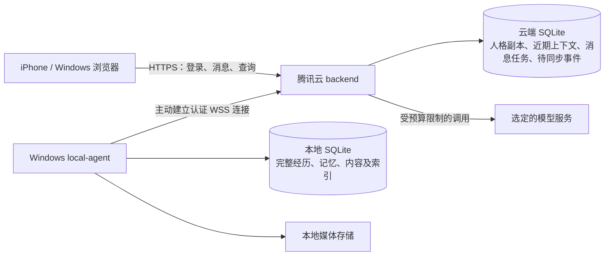

# sakie-ai-home：现有项目架构审查与下一阶段实施方案

- 审查日期：2026-10-15
- 项目目录：`E:\sakie-ai-home`
- 审查基线：`main`，提交 `4406ef0`
- 本文件保存上一轮架构审查的完整结果。现状与验证结果对应审查当时的项目状态，不代表后续版本。
- A 为实际检查结果；B—F 为实施方案，尚未实现。
- 原审查未修改业务代码、数据库结构或生产环境，未提交或推送新代码。本次仅新增本报告文件。

**现有工程可以保留，下一阶段应优先建设“可靠落盘、可恢复迁移、幂等同步”，再接入模型和长期记忆。** 当前四类记录 API 是可用的基础数据层，但还不能支撑 Windows 离线聊天，也尚未形成记忆系统。

## A. 当前项目实际情况

### 1. 审查范围与验证结果

本轮读取了 `E:\sakie-ai-home` 的现有业务源码、模块说明、测试、依赖配置、锁文件信息、Docker/Nginx/Compose 配置及项目文档，并只读检查了真实数据库。

| 项目 | 本轮核验结果 |
|---|---|
| Git 基线 | `main`，提交 `4406ef0`，工作区干净 |
| 项目文件 | Git 跟踪 57 个文件 |
| Node.js | `v24.20.0` |
| 内置 SQLite | `3.53.4` |
| 类型检查 | `npm run typecheck` 通过 |
| 现有测试 | `npm test`：4 项通过，0 失败 |
| 真实数据库 | 完整性检查 `ok`，迁移版本 1，WAL 模式 |
| 数据记录 | 本机四张业务表均为 0 条 |
| FTS5 | 运行时支持，但项目尚未建立全文检索表 |
| Docker | 本机不可用，未做容器运行验证 |
| 腾讯云生产环境 | 未登录、未检查、未修改 |

这里的“0 条”只指本机当前数据库，**不代表服务器、备份或其他目录不存在历史数据**。本轮没有重新构建生产包，也没有验证域名当前实际运行的版本。

### 2. 已有模块

| 模块 | 后端实际能力 | 前端实际能力 |
|---|---|---|
| 首页 | 无首页专用 API | 基础文字页面 |
| 聊天 | 仅预留目录 | 占位页面 |
| 记忆 | 创建、分页列表、单条查询、删除 | 占位页面 |
| 日记 | 同上 | 占位页面 |
| 梦境 | 同上，校验 `ai/user` 来源 | 占位页面 |
| 活动记录 | 同上，时间规范化为 UTC | 占位页面 |
| 设备、音乐 | 仅预留目录 | 占位页面 |
| 动态、收藏夹、设置、人格、情绪 | 尚无对应实现 | 尚无对应页面实现 |

前端目前没有调用这些业务 API。路由集中在 [frontend/src/app/router.tsx](../frontend/src/app/router.tsx)，导航集中在 [frontend/src/app/Layout.tsx](../frontend/src/app/Layout.tsx)。

### 3. 数据库与 API

数据库文件：

```text
E:\sakie-ai-home\backend\data\sakie.db
```

现有表：

| 表 | 字段 |
|---|---|
| `memories` | `id, content, type, createdAt, importance` |
| `diaries` | `id, date, content` |
| `dreams` | `id, date, content, source` |
| `activities` | `id, time, type, content` |

四张表均有时间或日期排序索引。UUID、输入校验、参数化 SQL、分页、404 和基础错误处理已经实现。

现有 API 基础路径为：

```text
/api/memories
/api/diaries
/api/dreams
/api/activities
```

每个路径支持 `POST /`、`GET /`、`GET /:id`、`DELETE /:id`，另有 `GET /api/health`。

但必须明确：

- `Memory` 目前只是可存取的记忆条目，没有检索、来源、关系或蒸馏能力。
- `Activity` 只是记录表，不是自主活动调度器。
- `Dream.source=ai` 只是分类字段，没有模型生成流程。
- 当前 `DELETE` 是物理删除。
- 当前迁移只有版本 1 的建表逻辑，没有完整的升级、回退及恢复工具。

相关实现位于 [backend/src/database/index.ts](../backend/src/database/index.ts)、[backend/src/database/migrations.ts](../backend/src/database/migrations.ts)、[backend/src/database/repository.ts](../backend/src/database/repository.ts)。

### 4. 当前数据流与部署方式

当前实际链路是：

```text
API 请求 → Express 路由 → 通用 Repository → 同机 SQLite
```

开发环境由 Vite 将 `/api` 代理到本机 `3000` 端口。生产配置是前端 Nginx 容器转发 `/api` 到后端容器，数据库保存在 `sakie-data` 数据卷中。

[compose.yaml](../compose.yaml) 默认发布 `8080`，但没有：

- Windows 本地服务及双端通信；
- 用户认证、设备认证；
- 消息队列或同步协议；
- 域名专用 HTTPS 配置；
- 模型适配器和成本统计；
- 内存、CPU、日志体积限制。

所以不能将“有 Docker 配置”描述为“已完成腾讯云安全部署”。

## B. 目标架构与数据流

### 1. 三端职责

建议保留现有 `frontend/`、`backend/`，增加轻量的 `local-agent/`，并用 `packages/contracts/` 共享协议类型。它们仍属于同一个项目，不拆成多套独立系统。



| 端 | 主要职责 | 不承担的职责 |
|---|---|---|
| 浏览器 | 页面、登录、发送消息、展示状态、网络重试 | 不持有模型密钥，不直接连接本地 SQLite |
| 腾讯云后端 | 用户鉴权、消息排序、模型调用、近期上下文、可靠待同步队列、调度决策 | 不加载全部长期记忆，不运行重型向量服务 |
| Windows 本地服务 | 完整归档、记忆检索、派生索引、内容历史、媒体、本地备份 | 不成为文字聊天回复的必经节点 |

浏览器始终访问 `sakiehome.icu`。用户不需要让 iPhone 直接连接家中电脑。

Windows 主动向云端建立 TLS 加密的 WSS 连接，避免依赖家庭公网 IP、端口转发或额外付费隧道。默认不需要开放本地 HTTP 服务；若以后需要本机管理接口，只绑定回环地址并鉴权。

两端各自打开自己的 SQLite 文件，**不通过 SMB、共享盘或网络挂载共同操作同一个数据库**。SQLite WAL 要求参与访问的进程位于同一主机。[SQLite WAL 文档](https://www.sqlite.org/wal.html)

### 2. Windows 在线与离线行为

建议明确区分：

```text
OFFLINE → CONNECTING → CATCHING_UP → ONLINE_READY
```

仅建立连接不代表完整记忆已经恢复。

| 情况 | 文字聊天 | 长期记忆 | 自主活动 |
|---|---|---|---|
| `ONLINE_READY` | 正常 | 按需检索 | 满足预算和调度条件时允许 |
| `CATCHING_UP` | 使用云端上下文继续 | 明确标注尚未完全恢复 | 暂停 |
| Windows 关机、断网或本地服务不可用 | 使用云端人格和近期上下文 | 返回不可用，不伪装为空库 | 暂停 |

云端必须持久保存有效的人格版本。Windows 离线时不得回退成空人格，也不得临时编造核心设定。若云端人格副本损坏，应报告配置错误，而不是继续以未知人格回复。

离线期间的新消息及回复先在云端可靠落盘，Windows 恢复后同步归档。近期上下文可以受预算裁剪，**待同步原始消息不能因此裁剪**。

### 3. 消息和同步协议

不能只靠 UUID 加定时复制。建议采用“至少一次传输、幂等入库、连续确认”的协议。

主要标识：

| 字段 | 用途 |
|---|---|
| `clientMessageId` | 浏览器重试同一消息时保持不变 |
| `messageId` | 消息的全局唯一 ID |
| `turnId / turnSeq` | 一轮对话标识及会话内处理顺序 |
| `eventId` | 同步事件唯一 ID |
| `producerId / producerSeq` | 来源设备及其持久化事件顺序 |
| `streamSeq` | 云端同步流中的顺序 |
| `aggregateId / baseRevision` | 可编辑对象及修改所基于的版本 |
| `payloadHash` | 检查重发内容是否一致 |
| `schemaVersion` | 协议兼容与升级 |

ID 负责身份，顺序字段负责排序，不使用 UUID 或设备时间决定处理顺序。

建议消息流程：

1. 浏览器创建并保留 `clientMessageId`。
2. 云端在同一事务内写入用户消息、对话任务、同步 outbox。
3. 事务持久提交成功后，才返回“已接收”。
4. 同一会话的任务按 `turnSeq` 串行执行。
5. 回复落盘后才标记完成，并加入同步队列。
6. Windows 在本地事务中完成归档和去重记录后，发送 ACK。
7. 云端保存已确认游标，再按保留策略清理已同步副本。

同一 `clientMessageId`、同一内容的重试返回原结果；同一 ID 携带不同内容应返回冲突，不能覆盖旧消息。

连续快速发送多条消息时，按轮次组装上下文，避免后发消息提前进入前一轮模型请求。显示顺序采用轮次和轮内顺序，同步日志另用 `streamSeq`，两者不混用。

断线恢复需要：

- 指数退避与抖动重连，重试状态持久保存；
- ACK 丢失时允许重发，接收端不重复写入；
- 不跨过未处理缺口推进确认游标；
- 对错误事件持久记录并报警，不静默丢弃；
- 恢复后先追平约定的同步水位，再开放完整记忆和自主活动；
- 从旧备份恢复本地数据库时，检查归档代次和游标，防止误认为已经同步完成。

云端可有近期副本保留上限，但**未确认归档的数据不能按 TTL 删除**。磁盘接近上限时先报警、停止非必要任务；确实无法落盘时必须明确拒绝新请求，不能返回虚假的成功。

任何有限磁盘都不能保证无限期离线存储，这需要在上线前确定容量边界。

### 4. 冲突与数据所有权

建议按对象明确写入权，避免全面双主数据库：

| 数据 | 写入规则 |
|---|---|
| 聊天消息和轮次 | 云端分配顺序，Windows 完整归档 |
| 本地派生记忆、检索索引 | Windows 生成，云端按需读取 |
| 人格核心设定 | 仅用户确认的版本生效，云端保留有效副本 |
| 日记、梦境、收藏等内容 | 版本化修改，基于 `baseRevision` 校验 |
| 设备信号 | 来源设备写入，保留采集时间及过期时间 |

日记等对象的并发修改使用版本比较：基于旧版本提交时保存冲突版本，不能用设备时间执行“最后写入覆盖”。

原始记录保持不变；修订、隐藏、归档和删除标记作为新事件保存。摘要、去重、衰减都不得物理删除原始经历。

### 5. 数据模型边界

下面是目标模型，不建议在第一阶段一次建完所有表。

| 范围 | 建议模型及关键字段 |
|---|---|
| 原始经历 | `SourceRecord(id, kind, origin, occurredAt, recordedAt, body, bodyHash, realityScope)` |
| 聊天 | `Conversation`、`ChatTurn`、`ChatMessage`；包含轮次、角色、原文、回复关系及事件引用 |
| 人格 | `PersonaVersion(id, version, content, hash, approvedBy, approvedAt)` |
| 近期上下文 | `ContextSummary`；包含覆盖范围、来源 ID、生成版本及摘要文本 |
| 同步 | `SyncEvent`、`Outbox`、`InboxReceipt`、`SyncCursor`、`ConflictRecord` |
| 派生记忆 | `MemoryItem`、`MemorySource`、`MemoryRelation`、`MemoryRevision` |
| 日记、梦境 | 保留现有对象 ID，增加独立修订历史及来源引用 |
| 活动与情绪 | `ActivityRecord`、`AutonomousTask`、`EmotionEvent` 分离 |
| 动态 | `FeedPost`、`Comment`、`Reaction`；点赞具有业务唯一约束 |
| 收藏夹 | `Favorite`，保存收藏对象、理由、来源和收藏时间 |
| 设备 | `Device`、`DeviceSignal`；包含可信来源、采集时间、有效期 |
| 媒体 | `MediaAsset`；包含哈希、类型、大小、位置及同步状态 |
| 成本 | `ModelCallAttempt`、`UsageRecord`、`BudgetReservation` |

这里有三个重要边界：

- 活动记录描述“实际发生了什么”，自主任务描述“准备做什么”，不能混成一张表。
- 情绪、自传和梦境属于主观或生成内容，不自动转成现实共同经历。
- 日记、动态等内容属于可检索来源，不是每次聊天默认注入的上下文。

现有记忆没有来源字段。迁移时只能保留并标记为 `legacy_unverified`，不能补造聊天引用或把旧条目自动认定为已验证事实。

### 6. 三层记忆及接口

三层保留为不同职责：

| 层 | 内容 | 生命周期 |
|---|---|---|
| 原始经历 | 完整聊天、真实事件、内容版本 | 不因摘要、去重或衰减而删除 |
| 蒸馏记忆 | 人物、关系、偏好、事件、状态 | 可修订，必须保留来源 |
| 自传记忆 | 对重要经历的主观理解及关联 | 可改变情绪和权重，不能改写事实依据 |

WrenWen 明确是文档仓库；可以借鉴三层和来源校验，但本项目应坚持原始事实作为证据，不能将主观自传设为事实冲突时的最高权威。[WrenWen 公开说明](https://github.com/ssxl0126/WrenWen)、[记忆设计](https://github.com/ssxl0126/WrenWen/blob/main/architecture/05-%E8%AE%B0%E5%BF%86%E7%B3%BB%E7%BB%9F.md)

Ombre Brain 可参考情绪维度、派生索引重建和降级思路；其文档同时指出相关性准入与重要度排序混用的风险。本项目应将两者分开，不复制其运行服务或随机补足检索结果的行为。[Ombre Brain 内部设计](https://github.com/P0luz/Ombre-Brain/blob/main/docs/INTERNALS.md)

建议内部接口：

```ts
MemoryService.search({
  query,
  sourceTypes,
  realityScope,
  minRelevance,
  maxItems,
  maxTokens,
  requiredArchiveWatermark
})
```

返回至少包括：

```text
status: ok | no_match | unavailable | degraded
items: 记忆正文、相关性分数、来源引用、来源版本和哈希
archiveWatermark
indexWatermark
retrievalVersion
```

另提供 `readSources(ids)`，让模型必要时进一步核验原文。工具输入和输出均有大小、次数及超时限制。

检索顺序建议：

1. 先做来源、权限、现实范围和状态过滤。
2. 相关性达到门槛才进入候选。
3. 再用重要度、时间、情绪权重排序。
4. 最后按条数和 Token 上限截断；允许零条。

重要度和情绪不能让无关记忆跨过相关性门槛。曝光、实际引用和人工确认也要分别记录，不能每次被召回就无限强化。

先在 Windows 评估 SQLite FTS5 的中文检索，再决定是否增加向量通道。不能把默认分词直接视为中文问题已经解决；例如 trigram 全文查询对不足三个字符的片段存在限制。[FTS5 文档](https://www.sqlite.org/fts5.html)

不引入 Mem0，不部署独立 OB 服务；向量方案也必须等本机硬件和数据规模评估后再定。

### 7. 上下文装配、缓存与成本

建议独立接口：

```ts
ContextAssembler.build({
  conversationId,
  triggerMessageId,
  archiveStatus,
  budget
})
```

返回模型消息、人格版本、摘要版本、来源引用、记忆可用状态、Token 估算和缓存指纹。

装配分层：

```text
稳定人格与规则、稳定工具定义
→ 带覆盖范围的历史摘要
→ 最近完整对话轮次
→ 当轮动态材料、按需记忆
→ 当前用户消息
```

供应商适配器负责映射具体消息格式。动态时间、设备信号和记忆结果不能随意插到稳定缓存前缀之前。缓存收益必须以实际 usage 验证，不能承诺复现 WW 的命中率。[WrenWen 成本与缓存设计](https://github.com/ssxl0126/WrenWen/blob/main/docs/04-%E6%88%90%E6%9C%AC%E4%B8%8E%E7%BC%93%E5%AD%98.md)

配置项至少包括：

```text
recentContextTokenBudget
summaryTriggerTokenBudget
retrievalMinRelevance
retrievalMaxItems
retrievalMaxTokens
sourceReadMaxTokens
localRpcTimeoutMs
maxToolStepsPerTurn
maxModelTokensPerTurn
dailyAutonomyBudget
```

不预先写死 WW 的召回数量、分数或窗口大小。摘要只处理未覆盖的新范围，保留来源边界，不能反复把全部历史重新摘要。

每次模型尝试均记录：

- 任务、轮次、用途、供应商、模型、请求 ID；
- 输入、输出、缓存读取、缓存写入等用量；
- 原始 usage、价格版本、币种及费用估算；
- 成功、失败、取消、用量未知状态。

不同供应商的缓存统计口径不同，必须归一化后计算，不能把已包含缓存的输入量再次累加。未返回用量记为未知，不能当作零费用。

预算在调用前持久预留，完成后结算；聊天、工具续轮、摘要、蒸馏、嵌入和自主活动均计入相应预算。模型响应丢失但可能已计费时，不盲目自动重试。同步幂等不等于供应商调用天然只执行一次。

页面加载、刷新、打开收藏夹、查看活动或设备状态只读 API，不触发模型调用。

### 8. 自主活动与资源约束

调度使用持久任务表和最近到期定时器，不用高频 LLM 轮询。任务领取使用租约，执行前和发布前均检查 Windows 就绪状态、预算及取消状态。

Windows 断开后不启动新自主调用；已发出的请求尽力取消，其费用和状态仍需记录，不能宣称网络请求可以被撤回。重新上线后按配置处理错过的任务，避免集中补跑。

对于 2GB RAM VPS，建议初始方案：

- 一个 Node 后端进程，SQLite 任务队列；
- 复用或对接现有 HTTPS 入口；
- 不部署 Redis、独立向量数据库或额外 AI 框架；
- 不在 VPS 本机运行嵌入模型；
- 媒体传输分块或流式处理，不整文件载入内存；
- 镜像在现有 CI 等构建环境生成，避免 VPS 同时承担编译峰值。

可将后端容器约 512MiB、前端 Nginx 约 64MiB 作为**待压测的初始上限**，不是已验证消耗。必须先清点服务器其他服务的实际占用；不足时停止部署，不能挤占已有服务。

## C. 现有问题及风险优先级

| 优先级 | 现有差距 | 具体影响与调整方向 |
|---|---|---|
| P0：公网使用前 | 无用户认证、设备认证；Compose 默认发布端口 | 若直接公网部署，业务接口可被访问。先加入鉴权和受控 HTTPS 入口 |
| P0：真实聊天接入前 | 无云端消息落盘、任务队列和同步 | Windows 离线要求无法成立；先实现持久接收和幂等同步 |
| P0：长期数据使用前 | `Repository.delete()` 物理删除 | 不适用于原始经历保留；调整为版本化事件、隐藏或删除标记 |
| P0：数据库升级前 | 无完整备份恢复及兼容回退 | 当前新版数据库会被旧程序拒绝；必须先设计迁移与回退边界 |
| P1 | 路由直接依赖 `DatabaseSync`，通用仓储承担业务操作 | 难以区分云端接收、本地归档和派生记忆写入；增加服务层和存储接口 |
| P1 | UUID 仅由服务端每次新建，无请求幂等键 | 客户端重试可能生成重复记录 |
| P1 | 无来源、修订和现实范围字段 | 无法核验记忆事实，梦境或生成内容可能污染真实经历 |
| P1 | [backend/src/shared/validation.ts](../backend/src/shared/validation.ts) 的 `text()` 会裁剪首尾空白 | 可以保留现有普通表单用途，但不能直接用于要求原文保真的聊天账本 |
| P1 | 无调用预算、成本账、调度在线闸门 | 后续模型接入容易出现重复费用和离线自主活动 |
| P2 | 无完整中文检索评测、媒体管线、移动端交互测试 | 应在数据与同步基础完成后建设 |
| P2 | 镜像构建安装两个 workspace 依赖，缺少资源及日志限制 | VPS 构建峰值和长期磁盘增长需要收敛 |

另一个边界是：[backend/src/database/index.ts](../backend/src/database/index.ts) 中虽然有 `DatabaseAdapter` 类型，但目前只有生命周期方法，也未成为业务代码使用的抽象，不能视为已完成可替换数据库架构。

## D. 分阶段实施计划

各阶段按顺序验收，不应跳过同步和持久化直接做“有回复的聊天页面”。

| 阶段 | 实施范围 | 可执行验收 |
|---|---|---|
| 1. 数据保护与接口基础 | 备份恢复、迁移框架、身份边界、配置校验、共享协议和存储接口 | 用带中文、特殊字符及历史 UUID 的 v1 临时库执行升级；逐表核对内容哈希；重复迁移不重复导入；失败可恢复；未登录请求不能读写 |
| 2. 双端服务与同步 | `local-agent`、设备配对、WSS、outbox/inbox、游标、冲突 | ACK 丢失重发同批事件十次，只入库一次；批次乱序不能跨缺口确认；接收中杀进程后可续传；同 ID 异内容被拒绝；撤销设备后无法连接 |
| 3. 无真实模型的聊天闭环 | 消息、轮次、持久任务、人格副本、近期上下文；使用假模型 | 关闭 Windows 后仍可提交并得到假模型回复；云端重启不丢已接受消息；快速发送多条消息保持轮次顺序；恢复后两端 ID、正文哈希和顺序一致 |
| 4. 模型适配与成本控制 | 选定模型、上下文装配、usage、预算预留、错误恢复 | Windows 关机后真实文字聊天可用；云端人格及上下文重启后仍在；无长期记忆时明确降级；预算耗尽不发请求；并发不能绕过预算；未知用量不记零 |
| 5. 可追溯记忆 | 三层模型、来源引用、中文检索、索引任务、主动查源工具 | 不存在的查询返回零命中；本地离线返回 unavailable；每条派生记忆可回查原文；伪造引语被拒绝；梦境不成为现实事件；索引重建不改原文；重复任务不生成重复记忆 |
| 6. 内容及媒体模块 | 日记/梦境修订、动态评论点赞、收藏、情绪、媒体、设备、音乐接口 | 并发编辑保留冲突版本；点赞重试不重复；内容可追溯修订；媒体断点续传后 SHA-256 一致；路径穿越被拒绝；设备过期信号不作为当前事实 |
| 7. 自主活动与整体验收 | 轻量调度、在线闸门、移动端页面接入、受控部署 | Windows 离线及追平期间自主调用为零；重启不重复执行任务；打开/刷新页面模型调用为零；iPhone 页面恢复后不重复发消息；负载测试不影响其他服务 |

阶段 7 中，页面接入以功能和移动浏览器可用性为目标，不先做 UI 美化。

每阶段涉及数据库变更时，共同执行以下验收：

1. 在数据库副本上演练，禁止拿唯一真实库测试。
2. 验证升级前后 ID、行数、原文哈希和外键。
3. 验证迁移中断后的事务状态。
4. 验证备份可恢复，不只验证备份文件存在。
5. 验证回退后的新写入不会丢失。

迁移策略采用“新增结构—兼容读取—迁移验证—切换”的方式，保留现有表与 ID。当前旧版本会拒绝较高 `user_version`，因此回退目标应先建立**兼容桥接版本**，不能承诺原 v1 程序可直接打开任意新库。

已经产生新数据后，禁止靠恢复旧快照直接回退；必须保存并重放这段增量，或回退到能读取新结构的兼容程序。SQLite 备份应使用一致性快照机制或受控停写备份，不能复制正在运行的单个主数据库文件当作完整备份。[SQLite Backup API](https://www.sqlite.org/backup.html)

## E. 第一阶段建议修改的具体文件和模块

以下仅是建议改动清单，原审查没有创建或修改这些文件。所有项目内路径均以 `E:\sakie-ai-home` 为根目录。

| 文件或目录 | 处理方式 | 第一阶段范围 |
|---|---|---|
| [backend/src/database/index.ts](../backend/src/database/index.ts) | 复用并调整 | 保留 SQLite，区分读写角色，校验路径、耐久设置和连接关闭 |
| [backend/src/database/migrations.ts](../backend/src/database/migrations.ts) | 调整 | 将 v1 保留为历史迁移；增加迁移登记、校验、备份前置条件及兼容性检查 |
| 新增 `backend/src/database/backup.ts` | 新增 | 一致性快照、恢复前校验、恢复演练接口 |
| [backend/src/database/repository.ts](../backend/src/database/repository.ts) | 有限复用 | 保留参数化查询和分页；将业务写入、修订及删除策略上移到服务层 |
| 现有四个 `backend/src/modules/*/model.ts`、`routes.ts` | 保留并逐步适配 | 保留 API 和现有 ID，定义未来来源、修订和存储接口；不一次重建所有模块 |
| [backend/src/app.ts](../backend/src/app.ts) | 调整 | 注入业务服务，加入认证边界；区分用户 API、设备通道及健康检查 |
| [backend/src/server.ts](../backend/src/server.ts) | 复用并调整 | 生命周期、角色启动、任务退出协调；保留优雅关闭 |
| [backend/src/config/env.ts](../backend/src/config/env.ts) | 扩展 | 云端/本地角色、存储路径、连接及预算配置；密钥不返回前端 |
| 新增 `backend/src/modules/auth/` | 新增 | 私人用户会话和设备凭据的独立权限边界 |
| 新增 `packages/contracts/src/` | 新增 | 消息、同步、来源、版本、错误和可用状态协议；不含数据库连接代码 |
| 新增 `local-agent/` | 第一阶段仅定边界 | 定义本地服务入口、配置及归档接口；实际连接放到阶段 2 |
| [package.json](../package.json) | 小范围调整 | 增加 workspace 及检查脚本，保留现有启动命令 |
| [backend/test](../backend/test/) | 保留并补充 | 原有 4 项继续运行；新增迁移、恢复、鉴权和数据保真测试 |
| [compose.yaml](../compose.yaml) | 后续有条件调整 | 第一阶段先准备资源、网络及数据卷方案，不直接替换服务器配置 |
| [README.md](../README.md)、[docs/data-layer.md](data-layer.md) | 更新 | 写清角色、路径、迁移恢复及已实现边界 |

现有 React 入口、路由、布局和七个模块目录继续复用。待服务接口稳定后再接入页面；不需要为了双端架构重写前端，也不需要立即引入复杂状态管理框架。

第一阶段的交付应是：**可保护现有数据、可演练升级恢复、具有明确权限及存储边界的基础工程**，不是提前交付 AI 聊天或自主活动。

## F. 需要用户确认的问题

第一阶段的本地接口、迁移和测试准备不依赖额外产品决定。以下事项只在对应阶段真正阻碍实施时需要确认：

| 事项 | 需要确认的内容 | 阻碍阶段 |
|---|---|---|
| 腾讯云现状 | 当前站点部署目录、反向代理方式、已占用端口、其他服务和实际资源余量 | 生产环境接入与部署；无需提供密码或私钥 |
| 云端保留边界 | 允许保存的近期上下文范围、Windows 最长预期离线时长、待同步数据容量及告警方式 | 云端清理和容量策略定稿 |
| 模型与费用 | 使用的供应商、模型、可接受的单次及周期硬预算 | 真实模型接入；此前可用假模型开发，不需要发送 API Key |
| 媒体存储含义 | 是否要求媒体二进制也写入 SQLite。建议文件保存在 E 盘媒体目录、SQLite 保存元数据与哈希 | 媒体模块；该建议尚未替你确定 |

目前最应避免的是：先接入模型让页面能回复，再补消息持久化和同步。应先用假模型完整通过 Windows 离线、云端重启、重复投递和恢复对账测试，之后再让真实调用进入同一条可靠链路。
