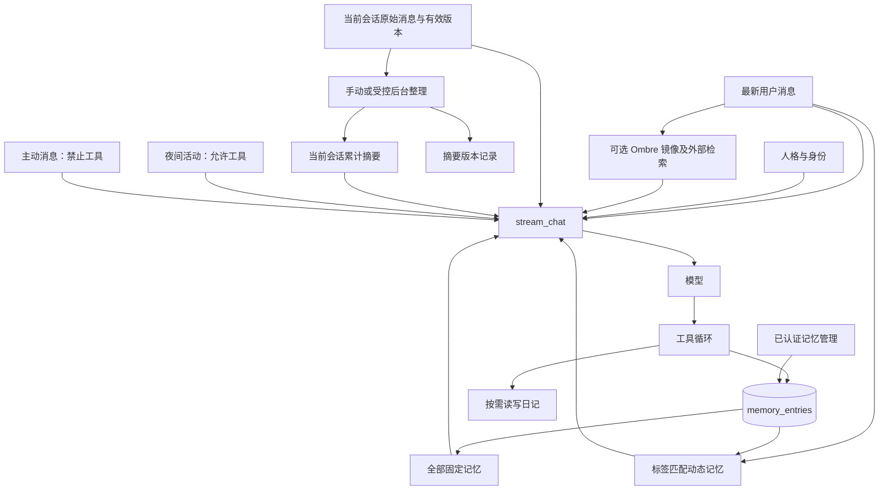

# Morrow 记忆系统源码审查（2026-10-27）

本次为只读源码和 SQLite 结构审查，未调用模型，未改数据库、UI、人设或记忆规则。依据部署源码 `4a15ffa324ec0b3e9e7832212a1b3ac721064ef7`，不是 README 推断。状态中的“已实现”表示代码存在，不代表用户实机验收通过。只查询结构、数量及非敏感开关，没有采集私人正文。本报告不包含生产路径、凭据或个人记录。

## 1. SQLite 表及数据关系：已实现

|表|用途与关联|
|---|---|
|memory_entries|content、kind=fixed/dynamic、tags、pinned、创建和更新时间；没有来源消息 FK、证据、置信度或修订表|
|memory_recall_events|memory_id 与 session_id 外键；记录动态记忆被注入，随所属记录删除级联清理|
|persona|独立单行人格正文，不是普通长期记忆|
|messages|会话原始消息、当前正文、versions、active version、附件、tool_log；不是不可变证据账本|
|conversation_summaries|每个 session 一个累计摘要、覆盖消息边界、原文重叠数及模型配置|
|conversation_summary_versions|摘要历史及 active/superseded/error/invalidated/reverted 状态、回退快照、覆盖边界与错误信息|
|image_descriptions|message_id、附件序号、图像哈希、描述及任务状态|
|diary_entries / diary_comments|日记正文、作者、标签、评论；独立于 memory_entries|
|night_runs|夜间活动日志、工具日志、自述、交接、上下文记录、恢复状态|
|ombre_recall_cards|外部 Ombre 卡片镜像，包含 importance、标签、正文、surface_allowed 等|
|ombre_recall_events / ombre_recall_sync|外部召回事件、评分及同步水位和状态|

审查时记忆、摘要、摘要版本、动态召回、Ombre 卡片及召回、日记、夜间运行记录均为零。只能确认结构已建立，不能宣称这些流程已实际成功运行。

## 2. 原始聊天、摘要、事实和主观印象：部分实现

聊天与摘要物理分表；人格与普通记忆分开。fixed/dynamic 表示注入方式，不表示事实/主观印象。没有事实、推测、自传和当前印象的严格分型，没有来源证据审核。AI 写入的推测可能与事实混在同一正文中。

## 3. 自动提取触发：部分实现

`app.py::chat_send → _stream_reply_impl → chat_engine.stream_chat → tools.openai_tools → 模型工具调用 → tools.execute`。`tools.py::write_memory / add_dynamic_memory` 允许模型主动保存；是否调用由模型决定，并非每 N 条消息必定触发。没有独立的后台事实提取、候选审核、幂等去重流水线。会话摘要不会自动拆成 memory_entries。

## 4. 注入上下文：已实现，实际效果待验证

`chat_engine.py::build_system_sections` 装配人格、身份、全部固定记忆、标签命中的动态记忆、可选 Ombre 和时间；`stream_chat` 再加入当前会话摘要与 `get_history` 返回的历史。固定记忆每次全量注入。动态召回通过 `record_dynamic_memory_recall` 持久记录。不要把函数陈旧注释中提到的所有背景资料都当成实际注入项。

## 5. 跨会话共享：已实现；细粒度受众权限未实现

memory_entries 是全局表，查询不按会话或 AI 身份过滤；固定记忆跨会话共享，动态记忆跨会话按标签触发。原始聊天和摘要按 session 读取。所有管理 API 有登录保护，但不是多人、多 AI、群聊/私聊的来源授权模型，不适合直接承担严格受众隔离。

## 6. 检索、重要性、容量和遗忘：部分实现

- `get_memory_entries`：固定记忆按 ID 全量注入，没有专用 Token 预算或重要性排序；pinned 主要用于管理列表排序。
- `get_relevant_dynamic_memories`：最新用户文本与标签做忽略大小写的子串匹配，最多 8 条，按 ID 顺序；无语义向量检索，较早记录可能占满窗口。
- `get_relevant_ombre_memories`：可选外部镜像关键词评分、重复召回抑制、importance 辅助排序，通常最多 2 条；必要时 MCP breath_search 补充。依赖选定服务与镜像，不能由代码存在推断外部服务已配置。
- 核心记忆没有自动衰减、容量淘汰或遗忘机制。模型主动删除不等于系统自动遗忘。
- 没有专门搜索本地 memory_entries 或全部原始聊天的 AI 工具。日记搜索不是记忆搜索。

## 7. 新增、修改、删除：已实现；可追溯性不足

`tools.py::write_memory/update_memory/delete_memory` 和 `add_dynamic_memory/update_dynamic_memory/delete_dynamic_memory` 直接操作 SQLite。模型工具轮次由 chat_engine 的 OpenAI/Anthropic 工具循环执行并回传结果。没有证据审查和来源版本验证，更新直接覆盖，删除物理删除；固定记忆 update_memory 没有同步更新 updated_at。旧工具日志、摘要及备份可能仍包含被删除内容。

## 8. AI 自主记忆与用户纠错：部分实现

模型可以选择记住并修改内容；用户可在管理页面纠正。没有单独的纠错优先级、矛盾合并、人工审核状态或记忆修订历史。编辑、撤回或删除来源消息不能自动撤销相关记忆，因为没有来源引用。不能将这种 CRUD 能力描述成证据可追溯的自主理解系统。

## 9. 压缩和原始记录：已实现保留；召回细节仍可能缺失

`app.py::_run_compression → _run_compression_claimed → compression_engine.summarize` 保存累计摘要和版本；`chat_engine.get_history` 根据覆盖边界裁剪进入模型的旧原文，可保留配置的重叠消息。压缩路径不删除 messages，但摘要本身有损，原文尚存不等于模型能主动检索任意旧细节。

手动整理和自动端点均有实现。当前默认自动整理关闭；普通聊天不再按旧阈值持续自动压缩。成功完成符合条件的夜间周期后，`_background_sleep_compression` 根据开关、选定会话与暂停状态触发。保存的会话列表会被限制为一个。失败写摘要错误版本并暂停相关自动整理，原检查点保留。

`_invalidate_summary_if_covered` 会在覆盖范围内消息被更改时使摘要失效，但不能同步失效无来源关联的长期记忆。上下文默认值也不能简单写成“固定 30 条”：API 的 `_context_limit` 支持不限量，最终受请求配置和摘要边界共同影响。

## 10. 日记、主动消息、夜间引擎：部分实现，运行效果待验证

|入口|读取|写入|
|---|---|---|
|普通聊天|固定/动态及会话上下文|模型工具可以写记忆|
|主动消息 proactive_engine._decide_attempt|复用 stream_chat 上下文|明确 allow_tools=False，不能在该次调用中直接写记忆|
|日记页面|显示存储日记|CRUD 日记，不自动抽取长期记忆|
|日记工具|browse_kept/search_kept/read_kept/read_kept_by_date 按需读取|write_kept/reply_kept；不是默认整本注入|
|夜间 night_engine._run_attempt|复用聊天与记忆|允许工具，可读写记忆和日记；成功周期可触发摘要和 Ombre 同步|

主动消息没有当前真实用户消息 ID 时，不满足 Ombre 自动召回的必要参数。夜间活动 self_recap 等字段提供活动留痕，不等于结构化自传记忆。审查时夜间记录为零，未宣称实际运行验证通过。

## 11. 前端管理：已实现，交互待用户验证

`static/index.html` 记忆管理调用登录保护的 `GET/POST /api/memory/entries` 和 `PUT/DELETE /api/memory/entries/<id>`，后端 `app.py::list_memory_entries/create_memory_entry` 及对应更新/删除处理。可查看、新增、修改、删除固定/动态记忆及设置标签、置顶；不是记忆修订与证据管理界面。UI 允许动态记忆无标签，而模型新增工具要求标签，前者可能导致记录永不被标签召回。没有进行真实数据写入验证。

## 架构

## 可复用与结论

可直接复用：SQLite CRUD、固定/动态上下文分离、模型工具循环、摘要版本与回退、日记按需访问、夜间运行日志、可选 Ombre 适配。没有重写或移植旧项目记忆系统。

当前适合作为单一可信家庭空间的轻量记忆基础。来源证据、事实/印象分型、记忆修订、撤权传播、细粒度受众控制、主动本地检索、容量治理尚不足。后续应先以合成数据验证来源关联与修订边界，再决定是否扩展；不应直接宣称完整长期记忆闭环或安全审计通过。
