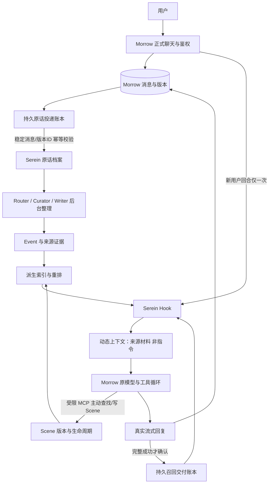

# Morrow + Serein 接入前审查

审查日期：2026-10-27（Asia/Shanghai）。性质：只读源码、数据库结构、资源状态审查与实施设计；不是部署或生产验收。

## 0. 结论、证据等级与范围

全文采用以下标记：

- **[源码]**：已从当前部署源码或本次固定版本源码验证；不表示已运行该功能。
- **[实测]**：本轮只读系统命令或 SQLite 结构查询的结果。
- **[文档]**：上游文档声明或其公开测量，未在本机复现。
- **[设计/待测]**：建议方案、估算、验收门槛或尚未运行的集成行为。

核心结论：

1. **[实测/待测]** VPS 实际为 2 vCPU、约 4GB 内存、60GB 系统盘，而非此前的 2GB。可以进入“同机、外部模型 API、低并发”的独立合成试部署候选；没有实测 Serein 运行峰值，不能保证正式容量或导入负载安全。
2. **[源码/设计]** Morrow 可以接 Serein 的完整链路，但现成配置不能直接构成闭环。推荐保留 Morrow 模型调用，组合 Hook 召回、受限 MCP 工具、持久原话投递与 Serein Event 后台任务。
3. **[源码]** Hook 不自动归档聊天；MCP 不自动获得全部聊天；Gateway 的归档失败也不等于一定自动补齐。接口成功不能替代完整链路验收。
4. **[设计]** 不删除或整体替换 Morrow 记忆模块。人格、会话历史和压缩保留；逐步明确普通长期记忆的单一写入权威，避免两套重复召回和写入。
5. **[源码/设计]** Aru 时间、角色、顺序和附件引用可保留，但 Serein 当前通用 Markdown 解析器不足以可靠解析所述 Aru 标题格式，需要专用转换适配。原始 Markdown 字节另行私有无损归档。

本轮没有安装依赖、运行 Serein、启动容器、停止/重启现有服务、修改线上配置/数据库、导入私人数据或调用模型。未读取真实凭据、人格或聊天正文。仅新增本报告；没有提交或推送 Git。

### 固定版本

|对象|核验版本与状态|
|---|---|
|VPS Morrow|**[实测]** `/opt/morrow`，HEAD `4a15ffa324ec0b3e9e7832212a1b3ac721064ef7`，工作树无改动|
|小家仓库 main|**[实测]** fetch 后为 `43f88619fb96cc4f194488f220e4ec41cd96c5f5`，包含上述部署源码及交接文档|
|Serein 上游 main|**[实测]** 本轮全新浅克隆，SHA `ec9f99e8cbc5abf6c024e668760e5cf55884c3dd`；只读，没有安装或执行代码|

源码链接固定到 SHA，后续 upstream 更新必须重新比较相关接口，不能以分支名代替版本契约。

## 1. Morrow 当前系统真实情况

### 1.1 运行与持久化

**[实测]** `morrow.service` 为 active；专用用户 `morrow`，工作目录 `/opt/morrow`，Python 3.12.3。Gunicorn 1 worker、gthread 8 threads、监听 `127.0.0.1:5151`，请求超时 180 秒、优雅退出超时 120 秒。主站 Nginx 仍代理到这个回环端口。本轮未访问任何写入 API。

**[实测]** 正式库 `/opt/morrow/data/nook.db`，通过 `mode=ro` 和 `query_only=on` 查询结构；当前 `journal_mode=delete`、`user_version=0`。该值不是旧项目 v4/v5，禁止据此沿用旧项目迁移编号。数据目录当前约 388 KiB，此体积不代表未来聊天规模。

### 1.2 聊天、流式与上下文调用链

**[源码]** `app.py::chat_send` (`POST /api/chat/send`) 先校验并提交用户消息，再经 `_stream_reply → _stream_reply_impl → chat_engine.stream_chat` 调模型；助手正文、有效版本、工具日志及用量在回复链路保存。`chat_engine.get_history` 读取当前会话当前有效正文、版本和可重放工具历史，累计摘要的覆盖边界决定哪些较早原文退出当次输入。

**[源码]** `stream_chat` 经 `build_system_sections` 装配稳定人格/身份/固定记忆与动态记忆、Ombre、时钟，加入同会话摘要与历史后，进入 OpenAI/Anthropic 工具循环。OpenAI `_stream_openai_once` 请求 `/chat/completions`，流式片段解析后由 Flask SSE 发给前端；工具执行后结果进入同一回合续轮。`tools.openai_tools → _openai_mcp_tools → tools.execute` 已支持服务端发现和执行 MCP。

**[源码]** 不能直接把请求上下文当作原话归档：里面混有系统设定、摘要、召回、工具结果和隐藏背景。归档应从已保存的用户/助手消息投影，分别保留版本与可见性信息，不能重新导入渲染后的 prompt。

### 1.3 现有记忆相关结构

|结构|作用|接入时保留/调整边界|
|---|---|---|
|`persona`|独立人格正文|保留，不给 Serein 普通记忆写入覆盖|
|`messages` / `sessions`|原始聊天、版本及会话|Morrow 继续是正式聊天保存源|
|`memory_entries`|fixed/dynamic、标签和置顶|现有功能保留；接入时明确与 Serein 的写入路由|
|`memory_recall_events`|动态记忆注入记录|不等同于 Serein 实际交付冷却账本|
|`conversation_summaries` / `conversation_summary_versions`|同会话累计压缩、版本和失效|保留，不等同于 Serein 跨会话 Event|
|`diary_entries` / `diary_comments`|独立日记、评论|首轮不批量同步到 Serein，防止重复资料及额外费用|
|`ombre_recall_cards/events/sync`|外部 Ombre 本地镜像、召回、同步|不能直接作为 Serein API 适配；防止与 Hook 重复召回|
|`tool_calls`、`messages.tool_log`|工具调用及结果|可能含私人内容，要纳入删除与备份策略|
|`message_artifacts` / `image_descriptions`|版本关联产物、图片描述|记录删除不等于物理媒体文件清理|

**[源码]** 固定记忆全量注入；动态记忆按最新用户文本标签匹配，最多 8 条、按 ID，而非语义排序。AI 可以调用六个记忆增改删工具，但没有独立的来源审核提取流水线。记忆表没有来源外键、受众权限或普通记忆修订历史。全局共享适用于单一可信家庭空间，不是多租户授权。

### 1.4 删除会话的实际行为：重要接入阻塞

依据 `app.py::get_db`、`delete_session`、`delete_message` 以及运行库真实外键：

|对象|删除会话后的实际结果|
|---|---|
|会话、消息、消息内 versions/tool_log|**[源码]** 路由先删除该会话消息，再删除 sessions，属于物理记录删除|
|累计摘要、摘要版本|**[源码/实测结构]** 对 sessions 的 ON DELETE CASCADE，随会话删除|
|图片描述、消息产物记录|**[源码/实测结构]** 对 messages/session 的级联外键清理记录|
|动态记忆召回事件|**[源码/实测结构]** session 外键级联清理|
|全局 memory_entries、人格、日记|**[源码]** 不随会话删除；没有来源关联可自动失效|
|独立 tool_calls 账本|**[源码/实测结构]** 没有消息或会话外键；delete_session 没有 DELETE tool_calls，可能留下孤立工具结果。单条 delete_message 路由有显式清理，二者行为不同|
|物理 uploads 文件|**[源码]** delete_session 没有 unlink/引用计数清理，不能宣称附件已擦除；关联记录消失不等于文件消失|
|Ombre 镜像卡片、未来 Serein 档案|**[源码/设计]** 外部/全局副本不随本地会话自动删除|
|备份与外部模型服务记录|**[设计/待测]** 不会因本地 DELETE 自动撤销，必须单独规定保留、撤权与到期清理|

**[设计]** 正式双写前必须定义“删除聊天是否同时撤回长期记忆”，并实现持久撤销/版本更新消息。不能把本地删除后仍可召回的外部副本当作正确行为。此轮不修复线上删除逻辑，也没有试删真实数据。

## 2. Serein 源码审查

### 2.1 运行要求与进程

**[源码]** `pyproject.toml` 要求 Python >=3.11，核心依赖 PyYAML、jieba、tzdata 等；HTTP/Embedding/MCP/background extras 引入 FastAPI、Uvicorn、httpx、MCP SDK、OpenAI SDK。没有默认必须加载本地 Torch/大模型的要求。可选 tokenizer 依赖 transformers，初期不应无评估启用。

**[源码]** `Dockerfile` 用 Python 3.13-slim；`deploy/Gateway.Dockerfile` 用 Node 22、npm ci、Vite build，再运行 `web/server/gateway.mjs`。官方 Compose 是 Python memory 服务 + Node 网页/入口服务两个服务；Python 内端口 8011，入口默认宿主 `127.0.0.1:18217`。不能把容器内部 `0.0.0.0` 误认为已开放宿主公网。

**[文档]** 直跑推荐 Node >=22.12；Docker 路线不需要宿主另装 Node。官方部署文档建议小内存构建时腾出资源，但本项目不能因此停止无关服务，应离机构建或安排获准的限额构建。

### 2.2 数据、索引与附件

**[源码]** `core/schema.sql` 的 canonical 主库保存 `documents`（scene/event/narrative、生命周期、当前 revision）、`revisions`（正文哈希、版本和元数据）、`sources`（原文与哈希）、`evidence_bindings/actions`、`deletions`、`import_records`（原始字节）。运行扩展再建立 `raw_events`、FTS、pipeline 批次/Track/job、导入任务、后台状态和索引 outbox 等表。不能只备份基础 schema 的七张表。

**[源码]** `compat/raw_archive.py::raw_archive` 把原话档案放进同一个 Serein 主 SQLite，不是 Morrow 库。`raw_events` 保存 source/source_event_id、角色、text、created_at、ingested_at、session/conversation、metadata；source+非空消息 ID 有唯一索引。

**[源码]** `recall/index.py` 将 FTS、文档 stamp、向量及派生段落存入独立 SQLite。向量以 JSON TEXT 保存，查询路径读取向量逐项做点积；不是 FAISS/HNSW/独立向量数据库。规模增长会增加 CPU 和临时对象，不能仅按主库大小或原话数量推断召回成本。原话并非每条都必然生成向量，Event/Scene 数与分段数更关键。

**[源码]** `IndexWorker` 默认每轮最多 100 个待办、约 5 秒检查；catch-up 可改为 500 个、积压时 0.1 秒，初期保留关闭。主库写入和索引成功分开，索引失败可以保持 canonical success/pending；检索会核对当前 canonical 状态/内容 stamp，不能把旧向量当作当前有效正文。

**[源码]** 附件不是统一只在一个目录：`pipeline_images.freeze_task_images` 在 `pipeline_media` 保存冻结图片 BLOB；另有原话附件 URL/元数据和叙事上传目录/文件。**[文档]** 图片另有独立持久文件，整实例备份须包含 runtime。首批 Aru 不取图片，禁止联网下载引用附件或猜测图片内容。

### 2.3 Hook 的真实契约

依据 `api/gateway.py::routes.recall`，不是只按 README：

```http
POST /api/hook/recall
Authorization: Bearer <服务端 Gateway Key>
Content-Type: application/json
```

```json
{"query":"上次提到的虚构读书会是什么时候？","session_id":"morrow:synthetic-session","max_notes":2,"max_chars":1200,"max_context_chars":4200,"delivered_ids":[],"exclude_ids":[]}
```

**[源码]** query 也接受 message/prompt 别名；max_notes 限制 0..5，默认 2；每卡字符限制 160..2400、总上下文限制 160..12000，默认分别 1200、4200。非 simulation 的召回 deadline 设为 9 秒，但不能把这个值当作端到端延迟或每个依赖调用绝对保证。调用语义 surface 检索，不是没有模型配置也自动完成的关键词兜底；未配置 Embedding 会报错。

**[源码]** 返回 `ok/query/session_id/cards/notes/recalled_ids/preferences/additional_context/debug/injected`；`injected` 明确为 false，debug 标明不登记注入。session_id 返回和传入不是用户权限验证；冷却需宿主显式传 delivered_ids。不要记录或公开包含正文的 cards/debug。

**[源码/文档]** Hook 本身不调用聊天模型，不归档宿主对话，也不证明上下文已进入模型。`examples/hook_host.py` 演示准备上下文和持久交付账本；仅在真正发送这份输入并完整成功后登记，同一窗口最近五次成功交付作为冷却，包括零记忆的成功回合；工具续轮复用本轮材料，不重复查、不重复确认。这个“五次”是该上游示例当前契约，不是给 Morrow 凭空制定的永久规则。

**[源码]** 服务端也有 `/v1/host/deliveries`，receipt_id 重复同内容幂等、不同内容冲突。应在宿主本地账本和服务端交付历史中选一个权威，不同时驱动同一条 Hook 链路的冷却。

### 2.4 MCP：自主 Scene、读取、检索、修订

**[源码]** `api/mcp.py::create_server` 提供 `read_memory`、`recall_memory`、`find_arc`、`read_arc_materials`，可按配置开放原话查找、Scene 写入、修订、状态变更、Event 纠正、日记等。显式检索和自动 surface 不是一回事；空召回也不代表没有旧经历。默认查找可以有被标注的词法补查，但错误不自动当作空结果。

**[源码，重要]** 必须继续读到 `create_server` 的后半段：公开 MCP 会用 `api/authored_tools.py::tools_for` **替换**前面定义的旧 operation_id/revision 参数版工具。当前客户端看到：

- `write_scene(content, cues, title?, date?, domain?, evidence_refs?, favorite?)`：内部生成 ID；无需来源也能写主观 Scene，evidence_refs 可选；独立重复调用可能新建多份，注解 idempotentHint=false。
- `edit_scene(scene_id, expected_updated_at, ...)`：基于当前时间戳做冲突保护。
- `set_scene_status`：active/archived/deleted，软删除；不是删除原话与所有历史字节。
- `edit_event(event_id, expected_updated_at, ...)`：纠正返回新 event_id、保留旧版本。
- `read_memory(..., with_evidence=true)`：必要时读取当前有效来源；删除/锁定不可通过历史版本绕过。

**[设计/待测]** 不能照抄旧 schema 要求模型传 operation_id 后便宣称所有工具重试安全。Morrow 要记录 tool_call_id、参数哈希、执行结果和“状态未知”；丢响应时先核查，不能盲重发 write_scene。更强的跨服务 exactly-once 需要另审一个真正支持客户端幂等键的写入契约，不能靠本地缓存单独保证远端调用已执行。

Scene 是主模型主观表达，可以没有证据；不得把这种 Scene 包装成已经证实的事实。Event 的证据流程与 Scene 的可选 evidence_refs 必须区分。

### 2.5 原话接收、Event 持续形成与限制

**[源码]** Python 核心的 `POST /api/ingest-raw` 在 `api/raw_archive.py`，接受 `events`/单条 event，支持 `X-Serein-Session-Id`；写入同一主库。`RawEventStore._insert_event_on_connection` 用 INSERT OR IGNORE，撞到已有 source_event_id 后返回 duplicate，**该路径未像文件导入器一样核对同 ID 的正文冲突**。Morrow 桥接必须校验已存正文/角色/hash，不能把 duplicate 当作相同内容已归档的充分证明。

**[源码]** `imports.py` 的文件导入批处理另有同 ID text/role 不同就报冲突、保留旧原文的逻辑。接口之间行为不同，须分别验收。

**[源码，入口边界]** Node 公共入口 `web/server/gateway.mjs` 的 Bearer 白名单有 Hook、Chat、models、deliveries 和 MCP；**没有 `/api/ingest-raw`**。不能默认通过 18217 给它发 Bearer 就能直达 Python。推荐后续授权部署时，Python 8011 只在回环/私有网络向 Morrow 开放，用实例 Bearer 调 ingest；或另审一条精确受保护入口。禁止把 Python 整个管理 API 直接公开，也不能绕过网页登录认证。

**[源码]** `extensions/event_pipeline.py` 注册约 30 秒 tick 的后台推进；`pipeline.scheduled_advance` 仍检查 auto_enabled，刷新归线后按该模块固定 UTC+8 的 03:00 后结算窗口/当天状态推进，并非每条聊天实时生成 Event。不能假设修改其他时钟配置会改变此处时区。启用扩展、开启自动摘要、阶段模型或 Agent 执行器就绪、新原话进入合格边界都必要。

**[源码/文档]** 流程为 Track Router → Event Curator → Event Writer → 校验/结算；成功阶段持久化，文字步骤累计三次失败后暂停批次；单个会话的后续材料可能等待恢复。不能承诺任意原话都立即成为 Event。首次开启和重新开启自动摘要建立新边界，历史文件默认仅归档；要用明确的 include/summarize 入口安排旧材料，不能误以为导入完会自动全量摘要。

**[文档，待模型验收]** Event 写作遵循原话，不补写感受/因果；Scene 是主观表达。证据与结构校验能约束输出，不等于模型的语义总结百分之百准确。需用否定、纠正、游戏/现实混合和同名人物材料验收。

### 2.6 Gateway 能做什么，不能保证什么

**[源码]** `api/chat.py::run_chat` 提供 `/v1/chat/completions`，解析 `X-Serein-Window-ID` 或 body 中的 serein.window_id，缺省落到 main。读取最新用户原话、召回、注入动态上下文、保留工具协议后转发真实上游；原生 Anthropic 可在服务端适配为 OpenAI 兼容响应。准备快照按窗口及模型/工具契约分隔，工具续轮缓存是进程内、最终答复后清理，不是持久原话库。

**[源码]** `chat_archive.prepare_turn` 优先当前消息稳定 ID，否则用窗口+历史内容哈希推导；Morrow 目前请求没有传 X-Serein-Window-ID，也没有统一传原始消息 ID。仅替换 Base URL 会让会话身份、上下文裁剪后的去重与再生成语义不可靠。

**[源码]** 成功响应的 completed 分支调用 `archive_turn`，只归档当前用户和最终非工具调用助手正文，不整段重导历史。正常文本用户并非必定在请求开始时落盘；图片路径另有预归档。流式必须完整结束且无错误才走 completed；不完整/断线不能登记为成功。归档异常会保留诊断但不丢掉已生成回复，**没有据此证明存在宿主级持久自动补投队列**。

**[源码]** 开启 memory 但检索尚未准备时 Gateway 返回 409，召回链路异常也可能阻断聊天；不天然满足“记忆故障仍可聊天”。若采用 Gateway，仍需额外的受控降级方案，且在输出/工具副作用发生后不能盲目重试整次模型请求。

### 2.7 备份、恢复、鉴权与许可证

**[源码]** `api/export.py::database_snapshot` 使用 SQLite backup API + quick_check 生成主库下载，**不是整实例备份**。`scripts/runtime_backup.py::snapshot` 是面向停写服务的 runtime+secrets+config/.env/installation 归档；gzip 不等于加密，该函数本身不替操作者保证服务已停止。恢复须另行操作，不得覆盖有新写入的运行库。

**[源码]** Python HTTP 非空 Bearer 必需，比较用 hmac.compare_digest；MCP 支持静态 Bearer 和有范围的 OAuth。Node 网页使用 HTTP Basic，密码记录为 scrypt+salt 哈希；入口有同源 JSON、MCP Origin 与 OAuth 公共 origin 检查。网页密码、实例 Gateway Key、模型提供方 Key 是三种凭据，不能互换。

**[设计]** 初期全回环，管理网页经 SSH 隧道访问，不新增 DNS/Nginx。容器如需宿主 Morrow 调核心，应精确回环发布或明确私有网络，不开放 8011 公网；不挂 Docker socket/宿主根目录/旧系统数据。实例 Key 目前是较高权限凭据，不假设它天然有只写单会话的细粒度权限。

**[源码]** Serein 根 LICENSE 是 MIT，Copyright 2026 ChiYouyu；Morrow 保留自己的 MIT。两个 germany/PROVENANCE.md 明确记录从 Ombre-Brain 特定提交派生；保留这些声明，不把兼容包名当独立私有部署证据。

**[源码/待核验]** Node lockfile 不是全 MIT：包含 MIT、ISC、MIT-0、Apache-2.0、BSD、字体 OFL-1.1、CC-BY-4.0，以及 GSAP 的专有 Standard “no charge” license。根 MIT 不覆盖这些条款。Python 依赖只核对了声明，没有安装锁定所有传递依赖或生成完整 SBOM；发布/再分发前要固定依赖并逐项保存许可证，GSAP、图标/字体归属尤其不能略过。此审查不是法律合规认证。

## 3. 接入方案比较与推荐

|方案|改动与收益|主要缺口/风险|判断|
|---|---|---|---|
|A：Morrow 调模型 + Hook|保留原供应商、流式、用量、工具循环；接入点集中在 stream_chat 装配前|只有召回；无自动原话归档和 Scene 写入|推荐作为召回骨架，不单独当闭环|
|B：Morrow → Serein Gateway → 模型|Serein 接管召回和成功轮次归档，MCP 另提供主动写入|双层流式/协议、窗口 ID、历史截断/再生成去重、进程内续轮缓存、归档失败补投、409 降级、双路用量与提示词注入；不是仅改 URL|后续可选，不作第一条生产接法|
|C：A + 受限 MCP + 原话持久桥接|召回、主动 Scene、完整归档、后台 Event 分工明确，可分别关闭，保持聊天稳定|需新增少量适配与持久投递/交付账本；删除与版本治理必须先做|**推荐**|

### 推荐数据流（尚未实施）



### 3.1 Morrow 最小改造位置（仅设计）

1. `chat_engine.py::stream_chat` 在进入模型前，经独立 `memory_bridge` 适配器 prepare 一次；调用 `build_system_sections` 的动态段加入有总字符/Token预算的来源材料。不能把原话中的命令升级成 system 指令，也不能改写现有人格。
2. `_run_openai_tool_loop/_run_anthropic_tool_loop` 的所有续轮复用同一份上下文和回合 receipt；完整最终响应后确认一次。首片段、工具调用结束和 HTTP 200 都不等于最终成功。ACK 失败仅补 ACK，不重新生成回答；流式中断不登记完整成功。
3. `app.py::_stream_reply_impl` 的实际消息提交、编辑、选版本、删除路径产生桥接事件。最佳方案是在同一个 Morrow SQLite 事务提交消息与 outbox；若选择 sidecar 库避免改表，必须通过持久扫描水位+内容hash对账弥补跨库事务空窗，不宣称天然原子。两者都需后续代码审查和正式备份/迁移授权，现阶段不执行。
4. `tools.py::_openai_mcp_tools/execute` 复用现有 MCP，不重写工具系统；只开放 read/recall/source-search、Scene 管理等必要工具，不给聊天模型 pipeline管理、批量导入、模型/密钥设置权限。记录非幂等写 Scene 的未知状态，避免丢响应后的自动重复写。
5. 后台 worker 只同步真实持久消息投影，不同步 provider Key、system、persona、工具结果、隐藏夜间控制记录或召回包装。部分生成明确标 partial，不当成成功的完整 AI 经历交给 Event；待最终提交或修订确认后再处理。

### 3.2 稳定标识、修订和删除

**[设计]** 安装实例 UUID + session ID + message ID + 已确认 version ID 构成稳定身份；不要仅用数字 ID，恢复、分支复制或换库可能重用数字。source=`morrow:<instance>`，source_event_id 包含消息与版本；相同 ID 相同 hash可重试，不同 hash必须阻断并登记冲突。Morrow 当前 versions 不等于 Serein revision，必须保存显式映射，不能直接混用数组下标。

原文保留历史并不意味着旧版本仍有资格被召回。选版本、编辑、软/硬删除、撤权须发送持久状态事件，撤销旧来源的检索资格及其派生证据，再激活当前版本。Serein 当前 ingest 不是通用 revise/retract 协议，不能通过重复 ingest 新正文实现更新。需审查可用的 sources/bindings/lifecycle 接口，必要时补一个精确适配；无法证明旧证据已不可用时，暂停该来源召回，不能继续静默泄漏。

### 3.3 避免重复、降级与费用

- **[设计]** 人格和当前会话摘要留在 Morrow；Serein 负责跨会话 Scene/Event。切换接入开关时抑制同一内容的原 memory_entries/Ombre 自动召回与旧记忆写工具，不删除旧数据。先对照稳定来源/映射去重，不能只凭语义相似度合并。
- **[设计]** Hook 超时/未准备/401/故障时停止该次召回、照常走原模型；记录中文诊断，不称“已经查过所有记忆”。使用短超时、失败熔断、无不必要重试；延迟预算在合成测量后确定，不能因上游 9 秒 deadline 就默认聊天可多等 9 秒。
- **[设计]** Serein 故障时原话 outbox 留存并退避，不影响聊天提交；队列和磁盘必须有告警。派生索引不可用不删除原话；未确认归档的消息不得按缓存清理。
- **[设计]** 现有模型调用保持不变；Embedding、Reranker、打标、Router/Curator/Writer 单独限额、记录费用和失败重试，所有额外付费/API资料传出先确认。关闭网页不触发新的回顾调用。
- **[设计/待测]** 用合成“独特事实”同时验证：Hook 返回、真实 payload含该来源材料、工具续轮不重复注入、最终回答可用、receipt成功持久化、重启后冷却恢复。不能只根据模型说“我记得”判断。

## 4. Aru 历史聊天迁移设计（不编写正式导入器）

### 4.1 为什么不能直接上传 Markdown

**[源码]** `imports.markdown_messages` 只识别带冒号的角色前缀/已配置双方名字，返回 role/content，不提取 ISO 时间；默认角色为 user。Aru 的“消息标题含说话者+时间”和 `---` 分隔，不保证符合它的正则。未命中时可能整段进入用户正文，不能宣称直接支持 Aru、保留时间。

### 4.2 两层归档、规范化格式

**[设计]** 第一层私有原文仓：保存每份 conversation Markdown 的原始 UTF-8 字节、SHA-256、原ZIP标识、相对文件名、解析器版本和导入manifest；不向模型注入整个文件。第一批不上传/抽取图片；若保留 ZIP，仅在用户已有私有保存位置保留，不把含附件整包发送给 VPS/模型。

第二层转换成 Serein 已支持的通用 `messages` JSON 或严格 events，通过已审查的文件导入器进入原话库；先归档不摘要。示例结构只能使用虚构文本：

```json
{"id":"aru-session-stable-id","title":"虚构会话","messages":[{"id":"aru-message-stable-id","role":"assistant","content":"虚构示例正文","created_at":"2026-10-24T16:11:30+08:00","aru":{"speaker":"谢亦言","sequence":1,"attachments":[{"relative_path":"attachments/example.png","status":"not_imported"}],"source_sha256":"<原Markdown摘要>","original_timestamp":"2026-10-24T16:11:30+08:00"}}]}
```

**[源码]** 通用导入保留 original_message/original_timestamp 元数据及会话标题，可容纳上述原始字段。但 raw ingest/过滤会清理特定上下文块，因此无损字节保障必须靠第一层，不应把投影等同原始文件。一次 preview受32MB限制，分文件/分批并保留身份，不能截断正文凑限额。

### 4.3 解析规则与身份

- **[设计]** 从一级标题取会话名称；按真实导出标题语法识别 speaker和ISO时间，只在代码块之外识别消息边界。`---` 在代码、正文引用或普通分隔用途内不能盲 split；完整消息才形成记录。
- 用户“你”→ user，谢亦言→ assistant，并在metadata保留显示名与稳定角色ID。其他说话者/系统标题进入待核对清单，不猜角色，更不将系统提示词当用户经历。
- 保存原始时间字符串及偏移，同时规范化为UTC用于比较；缺少时区单独标未知，等待用户确认，不默认为北京时间。显示时区不改历史瞬时。按原文件顺序保存 sequence；相同时间保留顺序，不仅按时间排序。
- 首选 Aru 的原生会话/消息 ID。若导出没有，先建立会话身份登记册：稳定 session UUID + 时间 + 角色 + 同时刻出现序号；保留正文hash作冲突校验，**不要把正文hash作为可编辑消息的唯一身份**。只有标题不足以区分同名会话，重导扩展版文件需映射到原 session，不能每次按整文件hash创建新会话。
- 不完整标题、重复原生ID、时间倒序/跨时区歧义、无法闭合代码块等给出预览阻断/人工核对，不默默修正或吞消息。使用一份保留结构但虚构内容的 Aru 样本锁定精确语法后才写解析器。

### 4.4 附件、幂等、暂停与回滚

- **[设计]** 保留 Markdown 原相对引用及 message_id→attachment序号/相对路径映射，状态 `not_imported`，不是“文件404”或“图片内容已知”；界面/工具不得编造描述。拒绝绝对路径、`..`逃逸、符号链接、ZIP炸弹和自动远程URL抓取。
- 两级去重：原文件hash相同复用任务；消息稳定ID相同正文/角色/时间相同跳过，不同则冲突。不能全库按相同文本删除重复的真实话语。现有文件导入器只核对正文/角色，转换层额外核对时间、身份和附件引用。
- 每批持久保存 batch_id、来源hash、解析版本、游标、已归档ID、错误及归属；事务成功后推进。复用 Serein 文件任务暂停/继续，先默认25条一批；不预先用250条高负载。暂停在当前批次提交后生效，重启后显式恢复，不重新调用模型做已完成阶段。
- 原话归档验收后，用户单独选择哪些会话生成 Event；Scene 不从历史自动伪造为“此刻模型亲自写下”。按阶段配额、窗口、费用和失败预算整理，允许查证后修订 Event。
- 试导入只在独立合成库，回滚可丢弃该新建测试实例。正式导入后的业务回滚优先撤回该批可见性和派生索引、保留审计；现有公共API没有被证明支持完整导入批撤销，**不可承诺一键无损回滚**。在补齐可验证批撤销前，应把真实试导入留在独立候选实例，禁止覆盖已有活动库。
- 后补图片按稳定会话/消息/附件序号绑定，校验文件hash后存独立私有媒体路径；文字和消息ID不重造。图片转录/重新整理是独立获准步骤，不能重导所有消息制造重复Event，也不能把未提供的图片当证据。

## 5. 资源评估：当前4GB与假设2GB分别判断

### 本轮只读快照

|项目|实际值|
|---|---|
|CPU|2 vCPU；采样时load average 0.00/0.00/0.00|
|内存|3659 MiB总量，约1130 MiB used，2529 MiB available；free约615 MiB，缓存可回收部分不能忽略|
|Swap|1987 MiB，当前使用0；不是替代正常内存的性能方案|
|磁盘|59 GiB文件系统，约12 GiB占用、46 GiB可用|
|Morrow cgroup|70,459,392字节，约67.2 MiB；进程RSS口径不与此相加|
|SakieTouch cgroup|47,435,776字节，约45.2 MiB|
|Phosphene容器|约223.9 MiB / 512 MiB限制|
|Phosphene relay cgroup|约12.2 MiB，与容器不同进程|
|其他常驻|Docker、系统日志、云安全服务等也占内存；系统available已包含总体结果|

**[实测限制]** 这是低负载瞬时快照，不是全天峰值、Serein运行实测或容量保证。没有运行 Serein/导入基准、构建或压力测试；不能声称Serein只需某个固定内存。

### 可选方案

|路线|判断|
|---|---|
|当前4GB同机，外部Embedding/Reranker/Writer，低并发|**[设计/待测]** 有进入隔离试运行的余量；推荐候选。离机构建镜像，关闭可选梦境/自主扩展，writer和embedding并发1、catch-up关闭；限额后测峰值与主站P95|
|假设真的2GB同机|**[设计/待测]** 同时运行现有服务、Node+Python、构建和导入风险明显；不能凭4GB快照承诺可用。优先不在宿主构建、小批原话归档，必要时仅私有Python API进程、不开放管理网页；这属于需单独验证的精简运行方式|
|Serein放Windows/另一机器|**[设计]** VPS开销低；但Windows离线时长期记忆不可用，Morrow必须降级且持久缓存待归档消息。跨公网必须认证加密、限定地址，不能暴露SQLite或无认证API|
|外部Embedding/Reranker API|**[源码/设计]** 代码支持HTTP客户端，可免本地模型；但有费用、延迟与隐私传出，必须用户确认，不自动新增付费服务|
|仅词法检索起步|**[源码/设计]** MCP手动检索可走lexical；Hook现路径强制semantic，不能宣称关掉Embedding后Hook仍保持完整功能。若接受降级需明确限定功能，不改门槛伪装高质量召回|
|升级服务器|只是备选，不是本轮结论或唯一解法|

**[设计]** 后续测量需分别记录空库常驻、合成归档、Event生成、索引和并发聊天阶段的cgroup峰值、CPU、磁盘/WAL、队列积压、召回延迟。可先给Serein合计约1GiB的试验上限作为失败保护候选，而非已测消耗；给主站保留至少约1GiB available作为初始停止门槛，具体值须按基线调整。限额触发OOM、主站延迟明显恶化、空间不能容纳完整恢复副本或索引持续积压则暂停Serein，不动其他服务。

## 6. 风险优先级与待解决事项

|优先级|问题|实际依据与上线门槛|
|---|---|---|
|P0|会话/消息删除、编辑、版本切换不能自动传播外部记忆撤销|Morrow无来源关系；Serein ingest不是通用撤回接口。证明旧证据不可读/不可召回后才允许真实双写|
|P0|归档丢响应、进程崩溃、同ID不同内容|持久outbox+状态核对+冲突阻断；无ACK前不清理源；不是仅重试HTTP|
|P0|重复Scene写入|当前公开MCP非幂等；未知状态先核查，不盲重试；否则不能承诺不重复|
|P0|高权限实例Token/公网原话API|回环或私网隔离、服务端私有凭据、受限MCP、独立管理入口；不得让网页获得Key|
|P1|记忆故障阻断聊天或增加首字等待|Hook熔断和超时降级；Gateway当前有409及依赖错误，不能假设自动降级|
|P1|双记忆重复、冷却错乱|明确单一记忆写入权威、receipt持久且按会话；只最终成功确认|
|P1|Event未持续生成|auto开关/扩展/模型/边界/夜间窗口和失败批次均可阻断；必须观察实际批次和来源绑定|
|P1|证据不足Scene被当事实、游戏现实混淆|保留来源和认知类别提示；合成用例核验，不能只看模型自述|
|P1|Aru直传Markdown丢角色/时间|专用解析适配和元数据/数量/字节hash对照；没有样本不猜标题语法|
|P1|备份不完整或明文泄漏|主库下载不含全runtime；停写整实例备份需加密、独立恢复、异地保留|
|P2|向量线性扫描、长文token截断、依赖许可证|代表性规模实测；核对模型真实token窗口，保留第三方声明/完整SBOM|

**[文档/源码]** 当前字符分段/预算不能保证Embedding或Reranker模型token窗口完整覆盖；切短字符或改召回分数都不能从根本上证明无截断。不得通过降低证据/相关性门槛掩盖问题。

## 7. 数据安全、备份与恢复设计

1. **[设计]** 后续获准后，Morrow先做SQLite一致性备份，校验schema/行数/完整性并恢复独立副本；同时保存uploads及部署版本/config。`backup_service.py` 可复用应用备份，但它的恢复是数据导入/替换路径，不得拿来覆盖正在产生新消息的主库。凭据独立加密保管，不进Git。
2. Serein备份包含主库、raw_events、全部版本/证据、后台任务与游标、索引、路由配置、图片/上传、实例配置和secret。对主库用backup API；跨主库/文件/索引的一致性通过短时停Serein写入或冻结明确水位建立。不能一边写一边tar后自称一致。
3. 备份文件自身加密、私有权限、SHA-256校验；同盘副本只用于恢复验证，不是灾备。异机/离线副本单独保存，恢复密码不与备份唯一同存。Serein官方runtime压缩包含secret而不自动加密，不能上传代码仓库。
4. 独立不存在的恢复目录里验证：SQLite完整性、记录/版本/绑定数量、抽样合成来源hash、索引重建能力及密钥配置；恢复生产前必须核对备份水位与新消息差异。失败回滚程序与开关，保留新库和待投递消息；不得旧快照覆盖新聊天。
5. 原话和模型输出、调试trace、source search、失败Writer返回都可能含隐私。生产日志只输出状态/耗时/脱敏ID，原文诊断仅私有受控访问。外部模型服务保留政策单独确认。

## 8. 后续分步实施、验收与回退（本轮全部未执行）

|步骤|动作与验收条件|失败停止/回退|
|---|---|---|
|1 完整备份|获准后备份Morrow和配置/媒体；独立恢复通过，确认磁盘空间和只操作归属明确的目录|备份/恢复失败不继续部署；原站保持不变|
|2 独立Serein|固定本SHA/依赖，独立目录/账户/数据、回环端口，默认可选功能关闭；鉴权、健康、限额、重启持久化通过|只停止新Serein；不动Morrow、Nginx和其他服务|
|3 虚构聊天|用独立空库验证Serein原话、Scene CRUD、证据、语义检索和费用日志；不得用真实聊天样本|保留脱敏证据，丢弃仅此次创建的测试实例；不清理其他资产|
|4 接Morrow读写|先独立Morrow副本接Hook+受限MCP；证明真实payload含记忆、工具续轮仅一次准备、失败正常聊天、Scene丢ACK不盲重写|关闭适配开关/恢复原程序；保留原话outbox待处理|
|5 归档与Event|稳定ID同步双方、崩溃/重试/重复/同ID冲突核验；配置自动窗口并观察Router→Curator→Writer→证据→Event→索引→召回，不只看任务成功字样|停新归档/整理，保留水位和已确认条目；不重导全库|
|6 修订与删除|编辑/换版/来源撤回/Scene软删/Event纠正后旧正文不可通过搜索、历史读取、引用继续泄露；范围不串会话身份，空召回有明确语义|撤销该来源自动召回，保留审计，未修复不启用真实数据|
|7 清除合成实例|确认所有对象来自测试instance/batch，独立库和其索引/附件/日志/备份的范围明确后再删除；不在生产库按关键词扫删|归属不明就保留并隔离，不扩大清理|
|8 真实历史候选|用户授权后，先一份conversation仅归档，核对角色/时间/顺序/引用/hash，独立候选库恢复验证；再按配额启用Event|原始导出永不覆盖；候选失败可退役候选；正式库批撤销未具备前不混入活动库|

每步保留固定版本、脱敏请求结构、数量/hash、水位、耗时、资源峰值和失败状态；不上传真实文本到Git。测试结果与手机可见效果分开，不用“接口通了”替代Event持续形成、撤权传播或用户验收。

## 9. 需确认的问题与最安全下一步

真正影响后续实施的事项：

1. 是否同意推荐的C方案（Morrow保留模型调用，Hook+受限MCP+原话持久投递），先只做独立合成候选，不接正式聊天？
2. 删除聊天的产品语义：同时撤回其来源支持的外部记忆，还是保留用户明确认可的独立记忆？在确定前默认不能继续召回已删除来源，不能静默永久保留。
3. Embedding、Reranker及Event阶段使用哪些已批准的服务、费用上限、私人材料传输范围？本轮没有读取或验证任何真实模型配置。
4. Aru是否存在原生会话/消息ID、ISO时区是否完整？实施解析前只需一份完全虚构且保留实际标题/分隔语法的样本，不需真实聊天。
5. 独立备份保存位置、加密恢复凭据保管方式与保留周期；正式导入后如何处置撤回数据的备份副本？

最安全下一步是**在本机全新合成实例中实现/验证C方案的最小桥接与Aru解析预览**，先解决重复写入、原话冲突和撤权传播；随后另行授权VPS独立限额试部署。当前没有理由替换主站、迁移生产库、导入真实历史或升级服务器。

## 10. 主要源码索引

Morrow部署基线（本仓库交接源码与该版本对应）：

- `app.py`：`get_db`、`chat_send`、`_stream_reply_impl`、`delete_session`、`delete_message`、`_invalidate_summary_if_covered`、`_run_compression_claimed`。
- `chat_engine.py`：`build_system_sections`、`get_history`、`stream_chat`、OpenAI/Anthropic工具循环与单轮流式请求。
- `tools.py`：内置记忆CRUD、`_openai_mcp_tools`、`execute`；`night_engine.py`、`proactive_engine.py`：后台入口权限。
- `backup_service.py`、`mcp_client.py`、`recall_sync.py`、`static/index.html`：备份、MCP、Ombre适配与管理页面。

Serein固定源码：

- [Hook实现](https://github.com/Yinglianchun/Serein/blob/ec9f99e8cbc5abf6c024e668760e5cf55884c3dd/src/serein/api/gateway.py)、[宿主示例](https://github.com/Yinglianchun/Serein/blob/ec9f99e8cbc5abf6c024e668760e5cf55884c3dd/examples/hook_host.py)。
- [Chat网关](https://github.com/Yinglianchun/Serein/blob/ec9f99e8cbc5abf6c024e668760e5cf55884c3dd/src/serein/api/chat.py)、[原话归档](https://github.com/Yinglianchun/Serein/blob/ec9f99e8cbc5abf6c024e668760e5cf55884c3dd/src/serein/chat_archive.py)。
- [当前公开MCP注册](https://github.com/Yinglianchun/Serein/blob/ec9f99e8cbc5abf6c024e668760e5cf55884c3dd/src/serein/api/mcp.py)、[实际Scene工具](https://github.com/Yinglianchun/Serein/blob/ec9f99e8cbc5abf6c024e668760e5cf55884c3dd/src/serein/api/authored_tools.py)。
- [原话接收](https://github.com/Yinglianchun/Serein/blob/ec9f99e8cbc5abf6c024e668760e5cf55884c3dd/src/serein/api/raw_archive.py)、`compat/germany/raw_events.py`、`imports.py`。
- `extensions/event_pipeline.py`、`extensions/pipeline.py`、`recall/service.py`、`recall/index.py`、`recall/worker.py`、`core/schema.sql`、`core/reader.py`。
- `api/export.py`、`scripts/runtime_backup.py`、`api/http.py`、`web/server/gateway.mjs`、`web/server/webAuth.mjs`。
- [上游Hook说明](https://github.com/Yinglianchun/Serein/blob/ec9f99e8cbc5abf6c024e668760e5cf55884c3dd/docs/hook-integration.md)、[导入说明](https://github.com/Yinglianchun/Serein/blob/ec9f99e8cbc5abf6c024e668760e5cf55884c3dd/docs/file-imports.md)、[规模测量](https://github.com/Yinglianchun/Serein/blob/ec9f99e8cbc5abf6c024e668760e5cf55884c3dd/docs/import-performance.md)：均未在本轮复测。

本轮未运行新测试、基准或模型请求；以上“源码验证”和“只读实测”均不等于集成运行验收。
